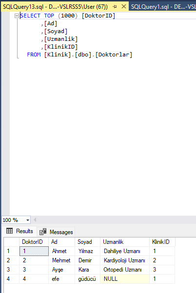

# Hasta Takip ve Klinik Uygulaması

Görsel Programlama dersi projesi — C# WinForms ile masaüstü hasta takip ve klinik yönetim uygulaması.

## Modüller
- Hasta kayıt ve takip (`FormHasta`)
- Doktor yönetimi (`FormDoktor`)
- Klinik yönetimi (`FormKlinik`)
- Randevu (`FormRandevu`)
- Tedavi kayıtları (`FormTedavi`)

Veritabanı: SQL Server Express (`Klinik` veritabanı, Windows kimlik doğrulaması).

## Çalıştırma
Visual Studio ile `HastaTakipVeKlinik.sln` dosyasını açıp derleyin (.NET Framework 4.7.2).
`Form1.cs` içindeki bağlantı dizesini kendi SQL Server örneğinize göre güncelleyin.

## Teknolojiler
C# · WinForms · .NET Framework 4.7.2 · SQL Server (ADO.NET)
